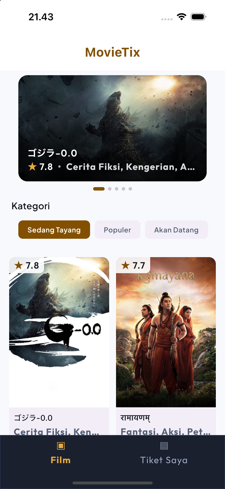
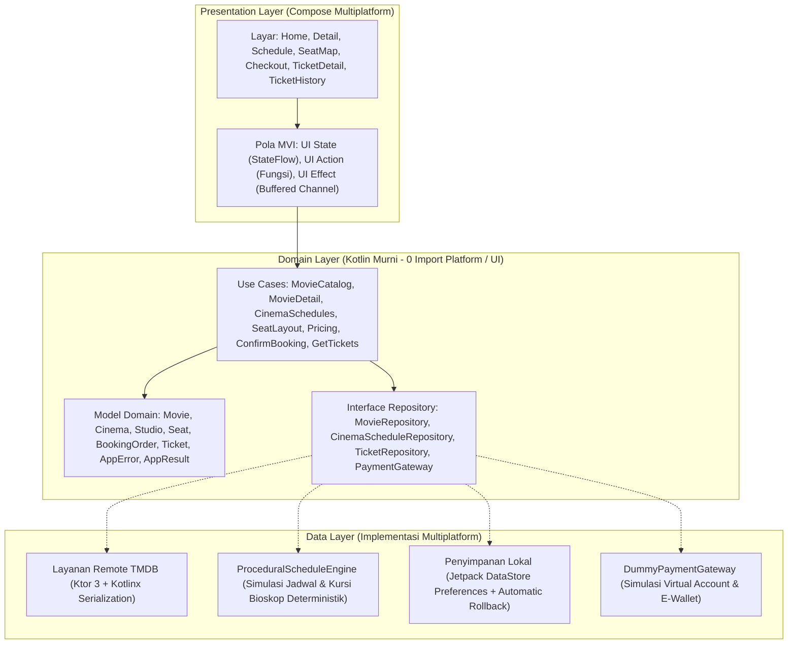

# MovieTix - Aplikasi Pemesanan Tiket Bioskop Kotlin Multiplatform

[](https://kotlinlang.org)
[](https://jetbrains.com/compose)
[](https://kotlinlang.org/docs/multiplatform.html)
[-success.svg)](docs/TESTING.md)
[](docs/ACCESSIBILITY.md)
[](THIRD_PARTY_NOTICES.md)

**MovieTix** adalah aplikasi pemesanan tiket bioskop berbasis **Kotlin Multiplatform (KMP)** dan **Jetpack Compose Multiplatform**, yang menargetkan platform **Android** dan **iOS** menggunakan 100% basis kode bersama (*shared codebase*).

Proyek ini dibangun dengan standar rekayasa perangkat lunak mobile tingkat industri: **Clean Architecture murni**, pola arsitektur **Model-View-Intent (MVI)** dengan aliran data satu arah (*unidirectional data flow*), design system bertema **"Midnight Cinema & Ticket Craft"** yang memenuhi standar aksesibilitas WCAG 2.1 Level AA/AAA, penyimpanan lokal persisten berbasis **Jetpack DataStore Preferences** dengan mekanisme *automatic rollback*, serta cakupan pengujian otomatis **121 unit & integration test** yang dieksekusi secara identik di target Android JVM dan iOS Simulator Native.

---

## Tampilan Aplikasi



> **Identitas Visual:** *Midnight Cinema & Ticket Craft*  
> Mengusung tema gelap Obsidian Navy (`#0B0E14`), kartu elevasi (`#1A202E`), aksen Amber Gold (`#E5A93C`) untuk aksi utama (CTA), dan aksen Neon Ember (`#F08C4A`) untuk badge promo. Seluruh kontras teks melampaui standar WCAG AA/AAA (hingga rasio `17.68:1`).

---

## Sorotan Rekayasa & Arsitektur



### Keunggulan Arsitektur MovieTix

1. **Clean Architecture & Isolasi Domain yang Ketat:**
   - Modul `domain/` sepenuhnya terisolasi dan berisi **nol** dependensi terhadap Ktor, DataStore, Compose, maupun platform SDK Android/iOS.
   - Diproteksi secara berkelanjutan oleh skrip audit otomatis (`scripts/audit_codebase.sh`).

2. **Mesin Jadwal & Kursi Prosedural Deterministik (`ProceduralScheduleEngine`):**
   - API publik seperti TMDB tidak menyediakan jadwal tayang lokal, tingkatan studio, dan denah kursi bioskop Indonesia.
   - `ProceduralScheduleEngine` menghasilkan data bioskop nyata di Indonesia (CGV, Cinema XXI, Cinepolis, FLIX), jenis studio (Regular 2D, Velvet Class, IMAX 3D, Premiere, Gold Class), serta sebaran kursi terisi yang realistis menggunakan algoritma hashing deterministik berbasis `(movieId, date, cinemaId, studioId)`.
   - Diuji dan dijamin konsistensinya lewat golden test (`ProceduralScheduleEngineTest`).

3. **Transaksi Pemesanan Atomik dengan Automatic Rollback:**
   - Proses reservasi kursi, transaksi gateway pembayaran, dan pencatatan tiket tersusun dalam alur transaksi yang tangguh.
   - Apabila simulasi gateway pembayaran gagal atau terjadi galat penyimpanan lokal, `ConfirmBookingUseCase` secara otomatis menjalankan **rollback pelepasan kursi** di DataStore, mengembalikan kursi menjadi status `AVAILABLE` bagi pengguna lain.
   - Diuji secara menyeluruh melalui integration test (`BookingFlowIntegrationTest`).

4. **Keahlian Tiket Fisik Berperforasi & QR Code Offline:**
   - Tiket digital dirancang menyerupai tiket bioskop fisik menggunakan Compose Canvas: lekukan setengah lingkaran (*punched notch*) di kedua sisi, garis putus-putus perforasi, dan kontras QR yang optimal.
   - QR code di-render langsung di atas Canvas menggunakan `io.github.alexzhirkevich:qrose`, sehingga tiket tetap dapat diakses dan divalidasi tanpa koneksi internet.

5. **100% Pengujian Bersama di JVM & Native iOS:**
   - **121 automated tests** di source set `commonTest` dieksekusi secara identik di runtime **Android JVM** dan **iOS Simulator Arm64 Native**.
   - Menggunakan Test Fakes, Turbine, dan `StandardTestDispatcher` tanpa ketergantungan pada library mocking berbasis manipulasi bytecode JVM (seperti Mockito).

6. **Tersertifikasi Aksesibilitas WCAG 2.1 Level AA & AAA:**
   - Skrip kalkulator luminansi otomatis (`scripts/calculate_contrast.py`) memastikan seluruh pasangan warna memenuhi standar W3C.
   - Teks utama pada kanvas mencapai rasio kontras **17.68:1** (syarat WCAG AAA >= 7:1); tombol utama mencapai **9.33:1**.
   - Laporan audit lengkap tersedia di [docs/ACCESSIBILITY.md](docs/ACCESSIBILITY.md).

---

## Teknologi yang Digunakan

| Lapisan | Teknologi | Kegunaan |
| :--- | :--- | :--- |
| **Bahasa** | Kotlin 2.1.20 | Bahasa multiplatform untuk Android & iOS |
| **Build Tool** | JetBrains Amper | Sistem konfigurasi proyek deklaratif dengan wrapper mandiri `./kotlin` |
| **UI Toolkit** | Compose Multiplatform 1.7.3 | 100% komponen UI deklaratif bersama untuk Android & iOS |
| **Pola Arsitektur** | Clean Architecture + MVI | StateFlow `State`, typed `Action`, buffered Channel `Effect` |
| **Dependency Injection** | Koin 4.0.0 | Kontainer DI multiplatform untuk ViewModel, Use Case, Repository |
| **Networking** | Ktor Client 3.0.3 | HTTP client multiplatform dengan engine OkHttp (Android) & Darwin (iOS) |
| **Serialisasi** | Kotlinx Serialization 1.8.0 | Parser JSON untuk DTO TMDB dan entitas DataStore |
| **Penyimpanan Lokal** | Jetpack DataStore Preferences 1.1.2 | Penyimpanan key-value reaktif dan transaksional |
| **Pemuat Gambar** | Coil 3.6.3 | Cache memori dan rendering asinkronus gambar poster |
| **Mesin QR Code** | QRose 1.0.1 | Rendering QR Code native di Canvas |
| **Testing** | Kotlin Test + Turbine + Coroutines Test | Suite pengujian unit dan integrasi multiplatform |

---

## Panduan Menjalankan Proyek

### Prasyarat
- **macOS** (untuk build target Android dan iOS) atau **Linux/Windows** (untuk target Android).
- **JDK 17** atau **JDK 21** terpasang (`java -version`).
- **Android Studio** (Ladybug / Meerkat atau versi lebih baru) dengan Android SDK 34+.
- **Xcode 16+** (untuk build target iOS di macOS).

### Konfigurasi Kredensial API TMDB
1. Dapatkan API Read Access Token gratis di [The Movie Database (TMDB)](https://www.themoviedb.org/settings/api).
2. Salin template konfigurasi:
   ```bash
   cp local.properties.template local.properties
   ```
3. Tambahkan token ke dalam file `local.properties`:
   ```properties
   tmdb.access_token=TOKEN_AKSES_BACA_TMDB_V4_ANDA
   ```
   *(Catatan: Aplikasi dapat berjalan secara aman dalam mode offline demo meskipun token belum diisi; simulasi jadwal dan pemesanan kursi tetap berfungsi penuh).*

### Menjalankan Aplikasi

MovieTix menggunakan script wrapper mandiri `./kotlin` dari JetBrains Amper (tidak memerlukan instalasi Gradle manual):

#### Jalankan di Android:
```bash
./kotlin run -m androidApp
```

#### Jalankan di iOS Simulator:
```bash
./kotlin run -m iosApp
```
*Atau buka file `iosApp/module.xcodeproj` di Xcode dan pilih simulator iPhone yang diinginkan.*

---

## Pengujian & Jaminan Kualitas

```bash
# Menjalankan unit & integration tests di Android JVM:
./kotlin test -p android -m shared

# Menjalankan unit & integration tests di iOS Simulator Native Arm64:
./kotlin test -p iosSimulatorArm64 -m shared

# Menjalankan audit konsistensi kode dan arsitektur:
./scripts/audit_codebase.sh

# Menjalankan verifikasi rasio kontras warna WCAG 2.1:
python3 scripts/calculate_contrast.py
```

### Integrasi Berkelanjutan (CI)
Alur kerja GitHub Actions multi-job telah dikonfigurasi di `.github/workflows/ci.yml`:
- **Codebase Audit:** Menjalankan `audit_codebase.sh` dan `calculate_contrast.py`.
- **Android Job:** Mengatur JDK 17 & Android SDK, menjalankan 121 tes, dan memverifikasi build rilis.
- **iOS Job:** Mengatur macOS-14, menjalankan 121 tes native di simulator, dan mem-build `MovieTix.app` via Xcode.

---

## Tautan Dokumentasi Teknis

- [Panduan Arsitektur (docs/ARCHITECTURE.md)](docs/ARCHITECTURE.md)
- [Spesifikasi Lapisan Data (docs/DATA_LAYER.md)](docs/DATA_LAYER.md)
- [Design System & Token Warna (docs/DESIGN_SYSTEM.md)](docs/DESIGN_SYSTEM.md)
- [Laporan Audit Aksesibilitas WCAG 2.1 (docs/ACCESSIBILITY.md)](docs/ACCESSIBILITY.md)
- [Arsitektur & Laporan Pengujian (docs/TESTING.md)](docs/TESTING.md)
- [Catatan Keputusan Arsitektur / ADR (docs/DECISIONS.md)](docs/DECISIONS.md)
- [Checklist Implementasi Fase 0 - 6 (docs/TASKS.md)](docs/TASKS.md)
- [English Documentation (README.md)](README.md)

---

## Atribusi & Ketentuan Hukum

- **TMDB API**: Produk ini menggunakan API TMDB namun tidak didukung atau disertifikasi oleh TMDB.
- **Tipografi**: Menggunakan font [Outfit](https://github.com/Outfitio/Outfit-Fonts) dan [Plus Jakarta Sans](https://github.com/tokotype/PlusJakartaSans) berlisensi SIL Open Font License 1.1.
- **Disclaimer Simulasi**: Seluruh jadwal bioskop, kelas studio, harga tiket, dan metode pembayaran disimulasikan secara lokal untuk kebutuhan portofolio. Tidak ada transaksi keuangan nyata yang dilakukan.
- Lihat [THIRD_PARTY_NOTICES.md](THIRD_PARTY_NOTICES.md) untuk rincian teks lisensi lengkap.
