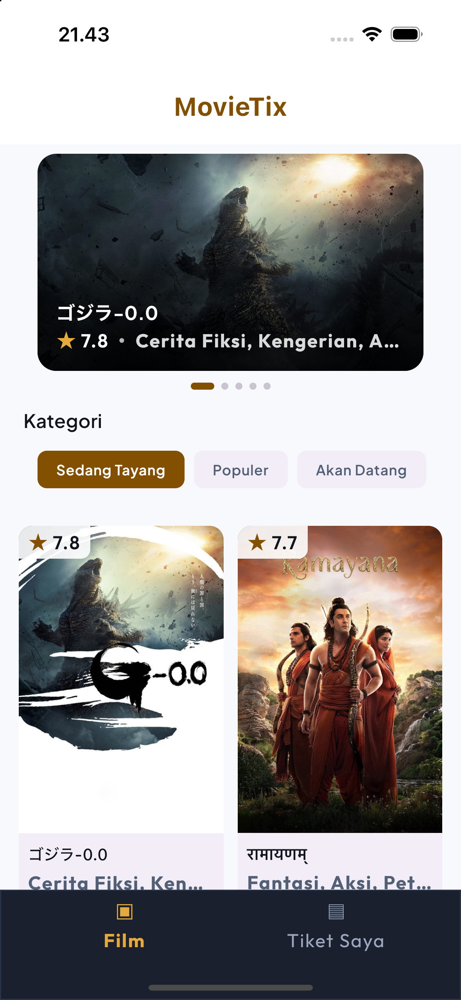
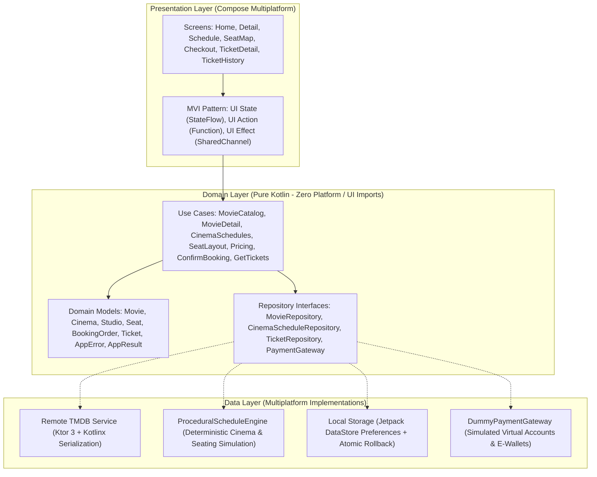

# MovieTix - Kotlin Multiplatform Cinema Booking App

[](https://kotlinlang.org)
[](https://jetbrains.com/compose)
[](https://kotlinlang.org/docs/multiplatform.html)
[-success.svg)](docs/TESTING.md)
[](docs/ACCESSIBILITY.md)
[](THIRD_PARTY_NOTICES.md)

**MovieTix** is a high-craft cinema ticket booking application built with **Kotlin Multiplatform (KMP)** and **Jetpack Compose Multiplatform**, targeting both **Android** and **iOS** from a single shared codebase. 

The project demonstrates modern, production-grade mobile architecture: **Strict Clean Architecture**, **Model-View-Intent (MVI)** with unidirectional data flow, a custom **"Midnight Cinema & Ticket Craft"** design system with WCAG 2.1 compliance, an offline-first **Jetpack DataStore** persistence layer with automatic transaction rollbacks, and **100% shared automated test coverage** across Android JVM and iOS Simulator Native targets.

---

## Screen Showcase



> **Design Aesthetic:** *Midnight Cinema & Ticket Craft*  
> Deep Obsidian Navy canvas (`#0B0E14`), elevated surface cards (`#1A202E`), Amber Gold interactive accents (`#E5A93C`), and Neon Ember promo highlights (`#F08C4A`). All typography pairs exceed WCAG 2.1 AA/AAA contrast guidelines (up to `17.68:1` contrast ratio).

---

## Architecture & Engineering Highlights



### Key Architectural Strengths

1. **Strict Clean Architecture & Domain Isolation:**
   - The `domain/` module contains **zero** imports from Ktor, DataStore, Compose, or platform SDKs.
   - Enforced continuously by automated regression scripts (`scripts/audit_codebase.sh`).

2. **Deterministic Procedural Cinema & Schedule Engine:**
   - Real-world cinema booking apps require showtimes, studio tiers, and seat layouts that public APIs like TMDB do not provide.
   - `ProceduralScheduleEngine` algorithmically generates authentic Indonesian cinema chains (CGV, Cinema XXI, Cinepolis, FLIX), studio classes (Regular 2D, Velvet Class, IMAX 3D, Premiere, Gold Class), and dynamic seat occupancy clusters based on cryptographic seeds `(movieId, date, cinemaId, studioId)`.
   - Verified via deterministic golden tests (`ProceduralScheduleEngineTest`).

3. **Atomic Booking Transaction with Automatic Rollback:**
   - Reserving seats, executing dummy payment, and storing confirmed tickets is structured as a resilient transaction pipeline.
   - If payment gateway simulation fails or storage writes encounter an error, `ConfirmBookingUseCase` automatically executes a **seat release rollback** in DataStore, restoring seats to `AVAILABLE` for other users.
   - Verified via end-to-end integration test (`BookingFlowIntegrationTest`).

4. **Perforated Ticket Craft & Offline QR Code:**
   - Tickets feature a custom physical ticket shape implemented via Compose Canvas: dual semicircular punched notches, dashed perforated cutting lines, and high-contrast QR display.
   - Offline QR codes are rendered purely on Canvas using `io.github.alexzhirkevich:qrose`, enabling boarding pass verification without an internet connection.

5. **100% Shared Testing on JVM & Native iOS:**
   - **121 automated tests** in `commonTest` execute identically on **Android JVM** and **iOS Simulator Arm64 Native**.
   - Zero reliance on JVM-only mock bytecode generators (e.g. Mockito); built with clean Test Fakes, Turbine, and `StandardTestDispatcher`.

6. **WCAG 2.1 AA & AAA Contrast Certified:**
   - Automated mathematical luminance audit script (`scripts/calculate_contrast.py`) verifies all foreground/background color token pairs against W3C formulas.
   - Primary text achieves **17.68:1** (WCAG AAA >= 7:1); primary CTA buttons achieve **9.33:1** (WCAG AAA >= 7:1).
   - Full audit report in [docs/ACCESSIBILITY.md](docs/ACCESSIBILITY.md).

---

## Technology Stack

| Layer | Technology | Purpose |
| :--- | :--- | :--- |
| **Language** | Kotlin 2.1.20 | Multiplatform language for Android & iOS |
| **Build Tool** | JetBrains Amper | Declarative multiplatform project system with standalone `./kotlin` wrapper |
| **UI Toolkit** | Compose Multiplatform 1.7.3 | 100% shared declarative UI components across Android & iOS |
| **Architecture** | Clean Architecture + MVI | StateFlow `State`, typed `Action`, buffered Channel `Effect` |
| **Dependency Injection** | Koin 4.0.0 | Multiplatform DI container for ViewModels, Use Cases, Repositories |
| **Networking** | Ktor Client 3.0.3 | Multiplatform HTTP client with OkHttp (Android) & Darwin (iOS) engines |
| **Serialization** | Kotlinx Serialization 1.8.0 | JSON parsing for TMDB DTOs and DataStore entities |
| **Local Persistence** | Jetpack DataStore Preferences 1.1.2 | Reactive, transactional key-value storage for booked tickets & seats |
| **Image Loading** | Coil 3.6.3 | Multiplatform image cache and async rendering |
| **QR Code Engine** | QRose 1.0.1 | Canvas-native QR code rendering |
| **Testing** | Kotlin Test + Turbine + Coroutines Test | Multiplatform unit and integration test suite |

---

## Project Structure

```text
MovieTix/
├── .github/workflows/ci.yml         # GitHub Actions CI for Android & iOS
├── androidApp/                      # Android application module
│   ├── src/MainActivity.kt         # Edge-to-edge ComponentActivity & Koin init
│   └── proguard-rules.pro           # ProGuard/R8 release keep rules
├── iosApp/                          # iOS application module
│   ├── src/ViewController.kt       # Compose UIViewController entry point
│   └── src/Info.plist              # Bundle display name & iOS config
├── shared/                          # Shared Kotlin Multiplatform module
│   ├── src/                         # Common shared code (Compose UI, Domain, Data)
│   │   └── org/ariqhikari/movietix/
│   │       ├── core/                # Design tokens, theme, errors, network
│   │       ├── domain/              # Pure Kotlin models, use cases, repository contracts
│   │       ├── data/                # TMDB API, schedule engine, DataStore repositories
│   │       ├── di/                  # Koin dependency injection modules
│   │       └── presentation/        # MVI ViewModels, Contracts, and Compose screens
│   ├── src@android/                 # Android-specific platform bindings (OkHttp engine)
│   ├── src@ios/                     # iOS-specific platform bindings (Darwin engine)
│   └── test/                        # 121 unit & integration tests (commonTest)
├── docs/
│   ├── ACCESSIBILITY.md             # W3C WCAG 2.1 contrast ratio audit report
│   ├── ARCHITECTURE.md              # Detailed architecture & MVI state machine guide
│   ├── DATA_LAYER.md                # Data sources, procedural engine, DataStore spec
│   ├── DECISIONS.md                 # Architecture Decision Records (ADRs 001 - 005)
│   ├── DESIGN_SYSTEM.md             # Design tokens, color palette, typography
│   ├── TESTING.md                   # Test architecture, test pyramid, coverage
│   ├── TASKS.md                     # Phase-by-phase implementation record (Fase 0 - 6)
│   └── screenshots/                 # Simulator screenshots
├── scripts/
│   ├── audit_codebase.sh            # Automated architecture & styling consistency check
│   └── calculate_contrast.py        # W3C luminance & WCAG contrast calculation script
├── libs.versions.toml               # Gradle Version Catalog
└── THIRD_PARTY_NOTICES.md           # Font licenses, TMDB notice, open-source licenses
```

---

## Getting Started

### Prerequisites
- **macOS** (for building both Android and iOS targets) or **Linux/Windows** (for Android target).
- **JDK 17** or **JDK 21** installed (`java -version`).
- **Android Studio** (Ladybug / Meerkat or later) with Android SDK 34+.
- **Xcode 16+** (for building the iOS target on macOS).

### Setting Up TMDB API Credentials
1. Register for a free API Read Access Token at [The Movie Database (TMDB)](https://www.themoviedb.org/settings/api).
2. Copy `local.properties.template` to `local.properties`:
   ```bash
   cp local.properties.template local.properties
   ```
3. Add your TMDB token to `local.properties`:
   ```properties
   tmdb.access_token=YOUR_TMDB_V4_READ_ACCESS_TOKEN
   ```
   *(Note: The app safely runs in offline demo mode even without an API token; procedural schedules and seat booking remain fully functional).*

### Building and Running

MovieTix uses the self-bootstrapping `./kotlin` wrapper from JetBrains Amper. No manual Gradle installation is required.

#### Run on Android:
```bash
./kotlin run -m androidApp
```

#### Run on iOS Simulator:
```bash
./kotlin run -m iosApp
```
*Or open `iosApp/module.xcodeproj` in Xcode and select your preferred iPhone simulator.*

---

## Testing & Quality Assurance

MovieTix features a comprehensive test pyramid with **121 automated tests** executing in `commonTest`:

```bash
# Run unit & integration tests on Android JVM:
./kotlin test -p android -m shared

# Run unit & integration tests on iOS Simulator Native Arm64:
./kotlin test -p iosSimulatorArm64 -m shared

# Run automated architecture & design system audit:
./scripts/audit_codebase.sh

# Run mathematical WCAG 2.1 contrast ratio verification:
python3 scripts/calculate_contrast.py
```

### Continuous Integration (CI)
A multi-job GitHub Actions workflow is configured in `.github/workflows/ci.yml`:
- **Codebase Audit:** Runs `audit_codebase.sh` and `calculate_contrast.py`.
- **Android Job:** Sets up JDK 17 & Android SDK, runs 121 tests, and builds release artifacts.
- **iOS Job:** Sets up macOS-14, runs 121 native tests on iOS Simulator Arm64, and builds `MovieTix.app` with Xcode.

---

## Documentation Links

- [Architecture Guide (docs/ARCHITECTURE.md)](docs/ARCHITECTURE.md)
- [Data Layer Specification (docs/DATA_LAYER.md)](docs/DATA_LAYER.md)
- [Design System & Tokens (docs/DESIGN_SYSTEM.md)](docs/DESIGN_SYSTEM.md)
- [Accessibility & WCAG 2.1 Audit (docs/ACCESSIBILITY.md)](docs/ACCESSIBILITY.md)
- [Testing Architecture & Report (docs/TESTING.md)](docs/TESTING.md)
- [Architecture Decision Records (docs/DECISIONS.md)](docs/DECISIONS.md)
- [Implementation Checklist (docs/TASKS.md)](docs/TASKS.md)
- [Bahasa Indonesia Documentation (README.id.md)](README.id.md)

---

## Attribution & Legal Notices

- **TMDB API**: This product uses the TMDB API but is not endorsed or certified by TMDB.
- **Typography**: Uses [Outfit](https://github.com/Outfitio/Outfit-Fonts) and [Plus Jakarta Sans](https://github.com/tokotype/PlusJakartaSans) licensed under the SIL Open Font License 1.1.
- **Simulation Disclaimer**: All cinema schedules, studio types, prices, and payment methods are simulated locally for portfolio demonstration. No real monetary transactions take place.
- See [THIRD_PARTY_NOTICES.md](THIRD_PARTY_NOTICES.md) for full licensing text.
