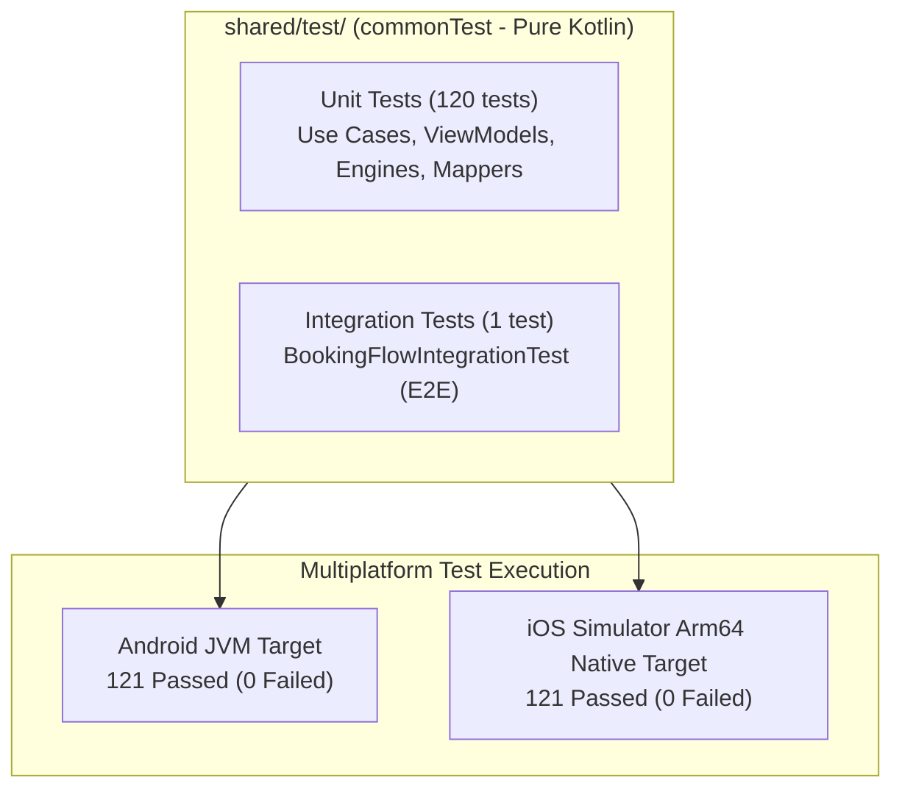

# MovieTix Testing Architecture & Verification Strategy

Dokumen ini menjelaskan strategi pengujian, arsitektur test, dan panduan reproduksi untuk aplikasi **MovieTix** (Kotlin Multiplatform: Android + iOS).

---

## 1. Test Architecture & Multiplatform Strategy

Pengujian pada MovieTix dirancang mengikuti prinsip Clean Architecture dan ditempatkan di source set `commonTest` (`shared/test/`). Pendekatan ini memastikan seluruh logika bisnis, kalkulasi harga, validasi pemesanan, dan state machine dieksekusi secara identik di dua target runtime:
1. **Android JVM** (`./kotlin test -p android -m shared`)
2. **iOS Native Arm64 Simulator** (`./kotlin test -p iosSimulatorArm64 -m shared`)

Tidak ada mock library pihak ketiga yang bergantung pada bytecode manipulation JVM (seperti Mockito). Semua pengujian menggunakan **Test Fakes**, **Turbine** untuk flow assertion, dan **kotlinx-coroutines-test** (`StandardTestDispatcher`, `runTest`).



---

## 2. Test Suite Breakdown (121 Passed Tests)

Total: **121 automated tests** terdistribusi di 24 file pengujian:

### A. Core & Infrastructure (8 tests)
- `SafeApiCallTest`: Verifikasi penanganan HTTP 200, 401 Unauthorized, 500 Server Error, timeout, dan kehilangan koneksi internet tanpa membocorkan stack trace.
- `TmdbTokenVerificationTest`: Memastikan token TMDB dapat dibaca secara aman tanpa hardcoded secret.
- `PlatformTest`: Verifikasi resolusi platform runtime di Android dan iOS.

### B. Movie Catalog & Detail (31 tests)
- `MovieCatalogUseCasesTest`: Pengujian `GetNowPlayingMoviesUseCase`, `GetPopularMoviesUseCase`, dan `GetUpcomingMoviesUseCase`.
- `MovieDetailUseCasesTest`: Pengujian `GetMovieDetailUseCase`, `GetMovieCreditsUseCase`, dan `GetMovieTrailersUseCase`.
- `HomeViewModelTest`: Pengujian state machine catalog, retry error, dan chip filter kategori.
- `DetailViewModelTest`: Pengujian expand/collapse sinopsis, pemilihan showtime, dan navigasi CTA.

### C. Cinema, Schedule & Procedural Engine (27 tests)
- `ProceduralScheduleEngineTest`: Golden test determinisme jadwal berbasis hash `(movieId, date, studio)` dan sebaran kursi terisi realistis.
- `CinemaScheduleRepositoryTest`: Pengujian penggabungan jadwal engine dengan reservasi pengguna di DataStore.
- `CinemaUseCasesTest`: Pengujian use case jadwal bioskop dan layout kursi.
- `ScheduleViewModelTest`: Pengujian pemilihan tanggal dan bioskop.
- `SeatMapViewModelTest`: Pengujian batas maksimal 6 kursi, perhitungan harga langsung, dan pencegahan double-booking.

### D. Booking & Payment (22 tests)
- `CalculateBookingPriceUseCaseTest`: Perhitungan subtotal, biaya layanan Rp 3.000 per tiket, dan total tagihan.
- `BookingCodeGeneratorTest`: Validasi format kode booking `MTX-YYYYMMDD-XXXXXX`.
- `QrPayloadFactoryTest`: Validasi format payload QR `MOVIETIX:v1:<code\>:<schedule\>:<seats\>`.
- `ConfirmBookingUseCaseTest`: Pengujian skenario reservasi kursi, transaksi gateway, penolakan kursi yang sudah terisi, dan otomatis rollback saat pembayaran gagal.
- `CheckoutViewModelTest`: Pengujian alur pembayaran, toggle simulasi debug, dan navigasi tiket.

### E. Ticket & Local Storage (32 tests)
- `TicketMapperTest`: Serialisasi dan deserialisasi entitas tiket ke domain model.
- `TicketStatusResolverTest`: Resolusi status `ACTIVE` vs `EXPIRED` berdasarkan waktu pertunjukan dan jam perangkat.
- `TicketRepositoryTest`: Penyimpanan persisten ke DataStore Preferences, pembatasan 50 tiket terakhir (FIFO), pengurutan descending, dan pemulihan otomatis dari payload JSON korup.
- `GetTicketsUseCaseTest`: Partisi tiket ke grup "Akan Datang" dan "Selesai".
- `TicketHistoryViewModelTest`: State machine riwayat tiket dan tab filter.
- `TicketDetailViewModelTest`: Pengambilan detail tiket spesifik berdasarkan booking code.

### F. End-to-End Integration Test (1 comprehensive multi-step test)
- `BookingFlowIntegrationTest`: Menguji interaksi nyata antar use case dan repository:
  1. Generate jadwal prosedural via `ProceduralScheduleEngine`.
  2. Query layout kursi awal dan verifikasi kursi tersedia.
  3. Pilih kursi dan hitung rincian harga (`CalculateBookingPriceUseCase`).
  4. Konfirmasi pemesanan sukses (`ConfirmBookingUseCase`) -> kursi tersimpan di DataStore, tiket tercatat di riwayat, payload QR valid.
  5. Skenario konflik -> reservasi kursi yang sama oleh pemesan lain ditolak dengan `SeatAlreadyOccupied`.
  6. Skenario kegagalan gateway (`simulateFailure = true`) -> rollback otomatis melepaskan kursi kembali ke `AVAILABLE`.
  7. Verifikasi tiket aktif langsung muncul di `GetTicketsUseCase`.

---

## 3. Cara Menjalankan Pengujian

### Menjalankan Pengujian Android
```bash
./kotlin test -p android -m shared
```
Output yang diharapkan: `Tests: 121 passed`

### Menjalankan Pengujian iOS Simulator
```bash
./kotlin test -p iosSimulatorArm64 -m shared
```
Output yang diharapkan: `Tests: 121 passed`

### Menjalankan Skrip Audit Kepatuhan
```bash
./scripts/audit_codebase.sh
```
Output yang diharapkan: `Audit Summary: 0 errors, 0 warnings.`
